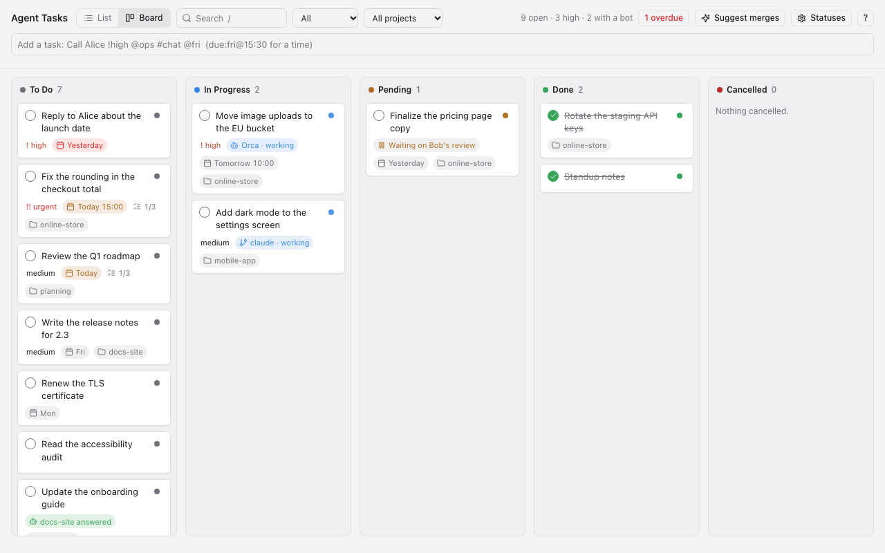
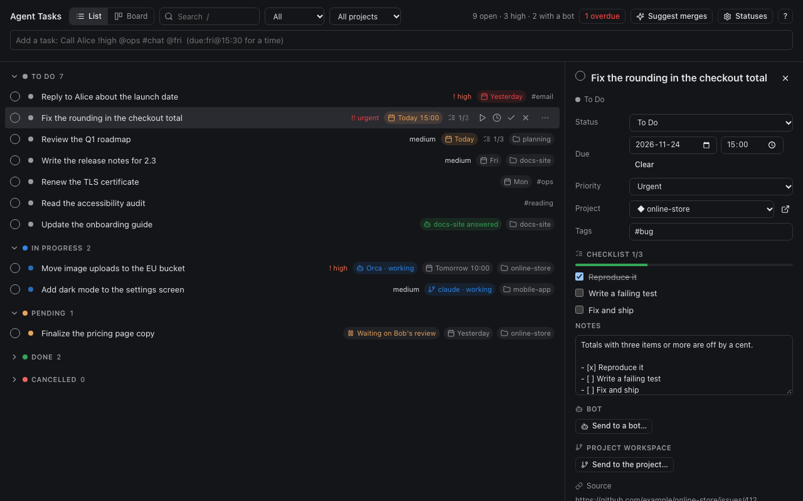
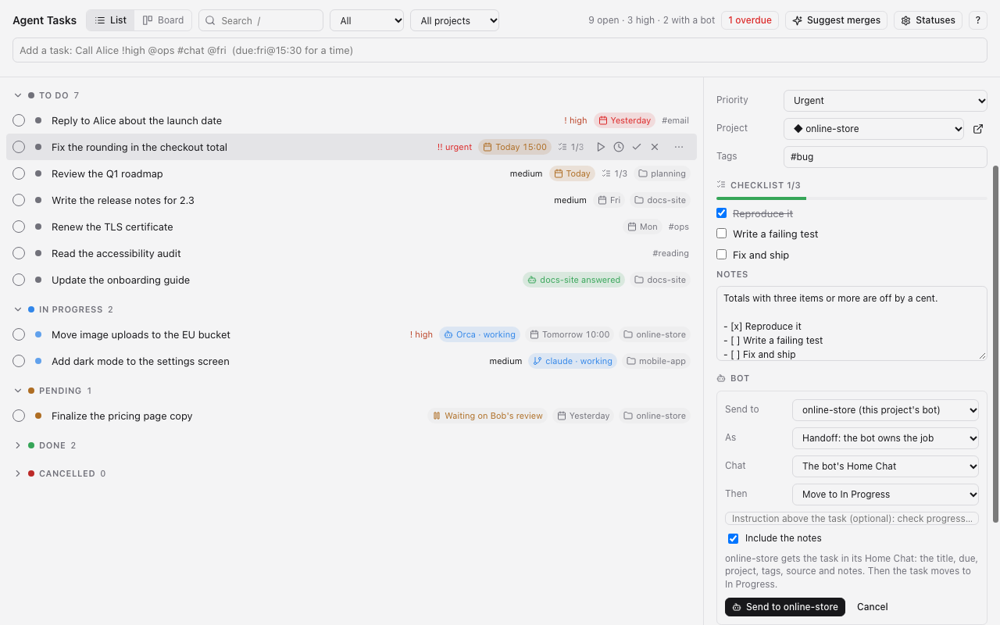

# Agent Tasks for Orca

A task list in [Orca](https://www.onorca.dev) that you and your agents share. You work with it in a
panel in the right sidebar and a board in a center tab; your agents use the `orca-tasks` command.
They all read and write one file, `~/.orca-tasks/tasks.json`. When an agent adds a task you see it
within a couple of seconds, and when you tick one off the agent sees that too. You can also hand a
task to one of your Orca bots, or start it in its project, in a workspace of its own with a coding agent.





## What it does

- **Statuses of your own.** You start with To Do, In Progress, Pending, Done and Cancelled. You
  can add, rename, recolour, reorder and delete them. Each one is open, on hold (waiting on
  someone), done or cancelled.
- **A sidebar panel and a board.** The panel has a section per status, a due filter and
  "Group by project". The board has a list and columns, a details pane, search and filters. In
  both you drag tasks between statuses or into order, and hover a task for quick actions.
- **Tasks.** A task has a title, notes, a due day and an optional time, a priority, a project,
  tags and a source (where it came from). `- [ ] step` lines in the notes become a checklist with
  progress. Quick add reads `Call Alice !high @ops #chat @fri@15:30`.
- **Reminders.** You get an Orca notification when an open task comes due. The status bar shows
  `12 open · 3 high · 2 overdue`.
- **Send to a bot.** Hand a task to the bot of its Orca project, the main bot "Orca", or any other.
  It can go as a handoff (the bot owns the job), a question or a status message. The task keeps
  the bot's state and latest reply.
- **Send to the project.** Start an Orca workspace of its own in the task's Git project, with Claude
  Code or Codex. The task is the agent's first prompt.
- **Merge duplicates.** Pick tasks to fold into one. Notes, sources, tags and history come along,
  and the merge can be undone. **Suggest merges** asks Claude Code which open tasks look like
  duplicates, and nothing merges until you confirm.
- **A CLI for agents.** `orca-tasks` can list, add, edit, complete, hold, send and merge tasks,
  with JSON output, stable ids and documented exit codes.



Everything is described in detail in the [reference](docs/reference.md).

## Requirements

- **Orca 1.4.259 or newer** (`engines.orca` in `orca-plugin.json`).
- **Node 22.18 or newer on `PATH`** for the `orca-tasks` CLI. **Send to a bot** also needs it,
  because the plugin runs the CLI in a terminal to send. The panel and the board work without it.
- **macOS or Linux.** The CLI is a POSIX shell script; Windows is not supported.
- Optional: Orca bots, for **Send to a bot**. A Git project in Orca, for **Send to the project**.
  Claude Code (`npm install -g @anthropic-ai/claude-code`, then sign in once with `claude`), for
  **Suggest merges**.

## Install

```sh
orca plugin install rickyking/orca-tasks
```

This installs the highest `vX.Y.Z` release tag (`@v0.6.2` picks one). The plugin runs code of its own, so
Orca first stops with `approval_required`. It lists the access the plugin asks for (see below)
and prints a fingerprint. Read the list, then run the command it prints:
`orca plugin install rickyking/orca-tasks --approve <fingerprint>`. It installs as
`rickyking.agent-tasks`.

Then:

- **The panel**: the check icon in the right sidebar's activity bar, or **Cmd+Shift+U**
  (Ctrl+Shift+U on Windows and Linux) to show or hide the sidebar.
- **The board**: **+** in the tab bar → **Open Agent Tasks board**. To reopen it with
  **Cmd+Shift+X** (Ctrl+Shift+X) or the panel's **Board** button, save that tab as
  `Agent Tasks.agenttasks` at the top of a workspace. The file stays empty, because the tasks come
  from `~/.orca-tasks`. See [The board](docs/reference.md#the-board).
- **The CLI**: see [For agents](#for-agents) below.

## Access it asks for, and why

The plugin runs a worker (`trusted-worker`): a Node process that Orca starts with your user
account's access to the machine. It is needed to read and write `~/.orca-tasks`, watch it for
changes, and send reminders. Orca keeps the worker running while the plugin is enabled, because the
plugin has a status bar item. The capabilities it asks for:

| Capability | Used for |
| --- | --- |
| `settings:own` | Its own settings: due reminders, the reminder time, and the Simple Todo inbox (below). |
| `workspace:read` | Reading your Orca projects (`project.list`), so a task's project matches one exactly. Reading their workspaces (`workspace.list`), to open one and to show what a project agent is doing. |
| `workspace:write` | Opening a project's workspace when you press its button (`workspace.open`), and opening the board file (`editor.open`). |
| `notifications:show` | Due reminders. |
| `terminal:send`, `terminal:read` | **Send to a bot.** Orca's mail needs a sender, so the plugin opens a background terminal in the focused workspace and runs `orca-tasks send` in it (`terminal.create`). It then reads the terminal's output for errors (`terminal.read`) and closes it (`terminal.close`). This happens only when you press Send. |
| `workspace:create`, `agent:launch` | **Send to the project.** It creates a workspace in the task's project with Claude Code or Codex, and the task as the agent's first prompt (`workspace.create`). This happens only when you press Send. |

Besides the capabilities, the worker runs two programs on your machine:

- **Orca's CLI (`orca`)**, for bots: `orca bot list`, `orca bot chats`, `orca agent read`, and
  `orca orchestration send --to bot:<name>` (only when you send).
- **Claude Code (`claude`)**, for **Suggest merges**, only when you press it (see Privacy).

## Privacy

- **Your tasks stay on your machine** in `~/.orca-tasks/` (below). The plugin makes no network
  requests of its own and has no analytics.
- **Suggest merges** runs `claude --print` once as a child process, with no tools, no MCP servers
  and no saved session. It gives Claude Code the open tasks (at most 300, the most recently
  changed): their id, title, notes (the first 1,000 characters), sources, tags, project, due day
  and status. **Claude Code sends that prompt to Anthropic's API** under your own Claude Code
  sign-in and settings, as it does any prompt you give it. Nothing is sent until you press
  **Suggest merges** or run `orca-tasks suggest-merges`. Without Claude Code it says so and does
  nothing.
- **Send to a bot** gives the task (title, due, priority, project, tags, status, source, id, and
  the notes unless you leave them out) to that Orca bot, as any `orca orchestration send` does.
  The bot's agent then works with it as it works with any message.
- **Send to the project** makes the task the first prompt of a coding agent in a workspace the
  plugin creates, as Orca's own workspace dialog would.

## For agents

When the plugin starts, it installs the CLI at `~/.orca-tasks/bin/orca-tasks`. It rewrites it on
every start, so it follows plugin updates. Add `~/.orca-tasks/bin` to `PATH`, or call the CLI by
its full path. Every command takes `--json`.

```sh
orca-tasks list --json                      # open tasks
orca-tasks list --view today --json         # due today or overdue, plus done today
orca-tasks list --done-since -24h --json    # finished in the last day
orca-tasks add "Reply to Alice about the budget" --due tomorrow --priority high \
  --project ops --source "chat:msg_123" --dedupe --json   # once per source
orca-tasks done t-k3m9x2pa --json
orca-tasks hold t-k3m9x2pa --on "Bob's review" --json
orca-tasks send t-k3m9x2pa --to Orca --dry-run           # what a bot would get
orca-tasks help                             # every command and option
```

An agent that can only append text can write lines such as
`- [ ] Call the bank !high @ops #chat due:tomorrow` to `~/.orca-tasks/inbox.md`, and the plugin
takes them in. The [reference](docs/reference.md#for-agents) covers every command, the JSON shapes,
statuses, bots, merging and the inbox.

## Shortcuts

| Command (palette) | macOS | Windows and Linux |
| --- | --- | --- |
| **Agent Tasks: Show or Hide Sidebar** | Cmd+Shift+U | Ctrl+Shift+U |
| **Agent Tasks: Open Board** | Cmd+Shift+X | Ctrl+Shift+X |

You can change them in Settings → **Shortcuts**, group **Plugins**. In the panel and on the board,
J/K or the arrows move, Enter opens, X or Space ticks, P puts on hold, C cancels, N adds, Esc
closes, and ? lists them all. See [Shortcuts](docs/reference.md#shortcuts).

## Where your data lives

Everything is in `~/.orca-tasks/`:

| File | What it is |
| --- | --- |
| `tasks.json` | The tasks and your statuses (and the latest merge, for undo). See [Data format](docs/reference.md#data-format). |
| `tasks.json.lock` | Held for a moment while something writes. |
| `inbox.md` | Lines agents append; the plugin takes them in and empties it. |
| `orca-projects.json` | Your Orca project names, for the CLI. |
| `reminders.json` | Reminders already shown, so a restart does not repeat them. |
| `send-prefs.json` | The send forms' last choices per project (never the instruction). |
| `merge-dismissed.json` | Merge suggestions you dismissed. |
| `ui-state.json` | What the panel and the board were showing. |
| `bin/`, `cli/` | The installed CLI. |

Write to `tasks.json` through the CLI rather than by hand: the CLI takes the lock and keeps the
file consistent.

**Simple Todo.** If your agents were told to append to
[Simple Todo](https://github.com/csavur/simple-todo)'s `~/.simple-todo/inbox.md`, turn on **Also
take in Simple Todo's agent inbox** in the plugin's settings. The plugin then takes those lines
in too. It is off by default; leave it off while you use Simple Todo.

## Uninstall

```sh
orca plugin uninstall rickyking.agent-tasks
```

This removes the plugin's files and its approval. Your tasks stay in `~/.orca-tasks/`, so a
reinstall picks them up again. To remove them too, together with the installed CLI, run
`rm -rf ~/.orca-tasks`, and take `~/.orca-tasks/bin` off your `PATH`. Any `Agent Tasks.agenttasks`
board files you saved in workspaces are empty and can be deleted.

## More

- [Reference](docs/reference.md): the CLI, statuses, projects, bots, sending to a project,
  merging, the board, keys, dragging, reminders and the data format.
- [Development](docs/development.md): loading a checkout, tests, screenshots and releasing.
- [Changelog](CHANGELOG.md).

## Credits

The board's layout, the details pane, the quick add words, due chips, the overdue toggle,
reminders and the `open · high · overdue` status count follow ideas from
[ToDos for Orca](https://github.com/uttam-gelot/orca-todos) by Uttam Gelot (MIT). The code here
was written for this plugin, and none of it is copied. The icons on the board are path data from
[Lucide](https://lucide.dev) (ISC; some icons derive from Feather, MIT). Their notices are in
[THIRD_PARTY_NOTICES.md](THIRD_PARTY_NOTICES.md).

## License

[MIT](LICENSE).
